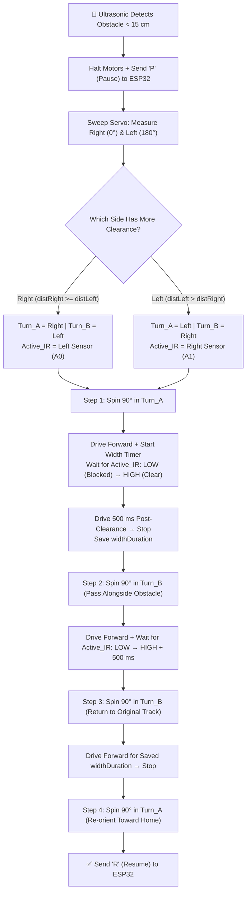

<div align="center">

# 🚗 S-M-A-R-T C-A-R: Autonomous RTH IoT Rover

### *Tri-Microcontroller Robotics Platform with Path-Reversal Return-to-Home, Active Obstacle Detouring & Live MJPEG Telemetry*

[](#)
[](#)
[](#)
[](https://github.com/jai-nithesh)

[**Architecture**](#-system-architecture) • [**Key Features**](#-key-features) • [**Hardware & Pinout**](#️-hardware-wiring--pinout) • [**Protocols**](#-communication--command-protocols) • [**RTH & Detour Logic**](#-autonomous-rth--active-detour-engine) • [**Setup & Calibration**](#-installation--calibration)

</div>

---

## 📖 Overview

**S-M-A-R-T C-A-R** (*Jai RC Rover*) is an embedded IoT and autonomous robotics platform engineered around a distributed **three-microcontroller architecture**. Operating completely offline via its own dedicated Wi-Fi SoftAP (`10.10.10.10`), the rover serves a **Dark Glassmorphic HTML5 Web Dashboard** with dual virtual touch joysticks, real-time bidirectional WebSocket telemetry, and a low-latency **ESP32-CAM live video stream**.

When **Return-to-Home (RTH)** is triggered, the rover mathematically inverts and replays its recorded movement stack (`MAX_STEPS = 500`) to retrace its path to the origin—autonomously pausing its playback timer to execute **ultrasonic + infrared closed-loop box detours** if a new obstacle blocks the return path.

---

## ✨ Key Features

- **🧠 Stack-Based Return-to-Home (RTH):** Records manual driving vectors and timestamps (`MoveStep` stack up to `500` steps) with automatic consecutive-command merging and a `50 ms` noise filter.
- **🛡️ Active Box-Detour Obstacle Avoidance:** During RTH, if an obstacle is detected within `15 cm`, the Arduino UNO halts ESP32 timer playback (`P`), sweeps an SG90 servo ($0^\circ$ to $180^\circ$), and uses side IR edge-detection sensors (`A0`/`A1`) to measure and navigate around the obstacle's exact width before resuming RTH (`R`).
- **🕹️ Glassmorphic Dual-Joystick Web UI:** Zero-app browser control (`http://10.10.10.10`) featuring 8-directional vector mixing (`F, B, L, R, G, H, I, J`), 4 speed gears, a `100 ms` safety watchdog heartbeat, and real-time battery/speed HUD telemetry.
- **📷 Dedicated ESP32-CAM Vision Node:** Streams live MJPEG video (`http://10.10.10.11:81/stream`) directly to the operator's HUD while supporting UART serial telemetry forwarding (`Serial1`) to the main controller.

---

## 🏗️ System Architecture

```mermaid
graph LR
    UI["📱 Operator Browser UI<br/>(HTML5 / Dual Joysticks)"]
    ESP["🧠 Main ESP32<br/>SoftAP: 10.10.10.10"]
    ARD["⚙️ Arduino UNO<br/>L293D Shield V1"]
    CAM["📷 ESP32-CAM<br/>Static IP: 10.10.10.11"]

    UI <-->|"WebSocket :81<br/>Commands & Telemetry"| ESP
    UI <-- "HTTP :80<br/>Serves index.h" --- ESP
    ESP <-->|"Serial2 (9600 baud)<br/>GPIO 16/17 ↔ A3/A2"| ARD
    ESP <-->|"Serial1 (115200 baud)<br/>GPIO 25/26 ↔ TX/RX"| CAM
    CAM -- "HTTP :81/stream<br/>Live MJPEG Video" --> UI
```

### 📂 Repository Structure

| File Path | Target MCU | Core Responsibility |
| :--- | :--- | :--- |
| [`Main_ESP32/Main_ESP32.ino`](./Main_ESP32/Main_ESP32.ino) | **ESP32 DevKit** | Hosts SoftAP (`Jai_RC_Rover`), HTTP Server (`:80`), WebSocket Server (`:81`), 500-step RTH stack engine, and UART bridge. |
| [`Main_ESP32/index.h`](./Main_ESP32/index.h) | *ESP32 PROGMEM* | Embedded responsive dark glassmorphic HTML5/CSS3/JS control dashboard. |
| [`Arduino_Controller/Arduino_Controller.ino`](./Arduino_Controller/Arduino_Controller.ino) | **Arduino UNO** | Drives 4× DC motors via `AFMotor` (L293D V1), polls HC-SR04 & IR sensors, and executes the 4-side box detour state machine. |
| [`ESP32_CAM/ESP32_CAM.ino`](./ESP32_CAM/ESP32_CAM.ino) | **AI-Thinker ESP32-CAM** | Connects to `Jai_RC_Rover` as a station client (`10.10.10.11`) and serves the OV2640 MJPEG stream on port `81`. |

---

## 🛠️ Hardware Wiring & Pinout

### 1. Arduino UNO & L293D Motor Shield V1 (`A0`–`A5` Header)

| Arduino Pin | Function | Connected Component / Destination |
| :---: | :--- | :--- |
| **`A0`** | Left Obstacle Edge Sensor | Left IR Sensor Module `OUT` (`LOW` = Obstacle, `HIGH` = Clear) |
| **`A1`** | Right Obstacle Edge Sensor | Right IR Sensor Module `OUT` (`LOW` = Obstacle, `HIGH` = Clear) |
| **`A2`** | `SoftwareSerial` RX | Main ESP32 **GPIO 17** (`TX2`) |
| **`A3`** | `SoftwareSerial` TX | Main ESP32 **GPIO 16** (`RX2`) |
| **`A4`** | Ultrasonic Trigger | HC-SR04 `TRIG` Pin |
| **`A5`** | Ultrasonic Echo | HC-SR04 `ECHO` Pin |
| **`D10`** | `SERVO_1` Header | SG90 Ultrasonic Sweep Servo (`0°` Right, `90°` Center, `180°` Left) |
| **`GND`** | Common Ground | Shared physical ground bus linking **ESP32 GND** & **ESP32-CAM GND** |

### 2. Quad-Motor Shield Mapping (`AFMotor.h`)

> [!NOTE]
> `Arduino_Controller.ino` maps the physical L293D ports as `mFR(4)`, `mFL(1)`, `mBL(2)`, and `mBR(3)` to match the rover's physical chassis wiring.

| AFMotor Object | Position | Code Port Mapping | Walkthrough Reference |
| :--- | :--- | :---: | :---: |
| **`mFR`** | Front-Right Motor | Port `4` (`mFR(4)`) | `M1` / `4,1,2,3` config |
| **`mFL`** | Front-Left Motor | Port `1` (`mFL(1)`) | `M2` / `4,1,2,3` config |
| **`mBL`** | Back-Left Motor | Port `2` (`mBL(2)`) | `M3` / `4,1,2,3` config |
| **`mBR`** | Back-Right Motor | Port `3` (`mBR(3)`) | `M4` / `4,1,2,3` config |

### 3. Main ESP32 Inter-Board UART Routing

| ESP32 GPIO | UART Bus | Baud Rate | Connected To |
| :---: | :---: | :---: | :--- |
| **GPIO 16 (`RX2`)** | `Serial2` | `9600` | Arduino UNO **`A3`** (`SoftwareSerial` TX) |
| **GPIO 17 (`TX2`)** | `Serial2` | `9600` | Arduino UNO **`A2`** (`SoftwareSerial` RX) |
| **GPIO 25 (`RX1`)** | `Serial1` | `115200` | ESP32-CAM **GPIO 1 (`U0TXD`)** |
| **GPIO 26 (`TX1`)** | `Serial1` | `115200` | ESP32-CAM **GPIO 3 (`U0RXD`)** |

### 4. Power Distribution

| Subsystem | Power Supply | Connection Terminal |
| :--- | :--- | :--- |
| **Arduino UNO + 4× DC Motors** | `7.4V` Dual 18650 Li-Ion Pack | L293D Shield `EXT_PWR` Terminal Block |
| **Main ESP32 & ESP32-CAM** | `5V` Regulated USB Power Bank | `5V` / USB Input Pins |
| **Common Ground Bus** | Physical Jumper Wire | Ties Arduino `GND`, Main ESP32 `GND`, and ESP32-CAM `GND` together |

---

## 📡 Communication & Command Protocols

<details>
<summary><b>1. Operator UI → Main ESP32 → Arduino UNO (Drive & Control)</b> <i>(Click to expand)</i></summary>

| Character | Action / Vector | Motor Differential Behavior |
| :---: | :--- | :--- |
| **`F`** | Forward | All 4 wheels `FORWARD` at `currentSpeed` |
| **`B`** | Backward | All 4 wheels `BACKWARD` at `currentSpeed` |
| **`L`** | Spin Left (Zero-Turn) | Left wheels `BACKWARD`, Right wheels `FORWARD` |
| **`R`** | Spin Right (Zero-Turn) | Left wheels `FORWARD`, Right wheels `BACKWARD` |
| **`G`** | Forward-Left (Diagonal) | Left wheels `currentSpeed / 2`, Right wheels `currentSpeed` (`FORWARD`) |
| **`H`** | Forward-Right (Diagonal) | Left wheels `currentSpeed`, Right wheels `currentSpeed / 2` (`FORWARD`) |
| **`I`** | Backward-Left (Diagonal) | Left wheels `currentSpeed / 2`, Right wheels `currentSpeed` (`BACKWARD`) |
| **`J`** | Backward-Right (Diagonal) | Left wheels `currentSpeed`, Right wheels `currentSpeed / 2` (`BACKWARD`) |
| **`S`** | Stop / 100ms Heartbeat | Releases all 4 motors (`RELEASE`) |
| **`1` – `4`** | Speed Gear Presets | Sets PWM duty cycle: `1` = `100`, `2` = `150`, `3` = `200`, `4` = `255` |
| **`M` / `m`** | Activate / Cancel RTH | Triggers or aborts autonomous Return-to-Home sequence |

</details>

<details>
<summary><b>2. Inter-MCU Handshakes & WebSocket Telemetry</b> <i>(Click to expand)</i></summary>

| Direction | Payload | Description |
| :--- | :---: | :--- |
| **ESP32 → Arduino** | `T` / `t` | Enables (`T`) or disables (`t`) ultrasonic obstacle scanning during RTH. |
| **Arduino → ESP32** | `P` | **Pause RTH Timer:** Sent immediately when an obstacle $< 15\text{ cm}$ triggers a detour. |
| **Arduino → ESP32** | `R` | **Resume RTH Timer:** Sent once the 4-step box detour realigns the rover with its path. |
| **Arduino → ESP32 → UI** | `BAT:100,SPEED:xx` | Broadcast every `500 ms` to update dashboard gauges. |
| **ESP32 → UI** | `MODE:RTH` / `MODE:MANUAL` | Toggles UI state and visual RTH pulse animations. |
| **ESP32 → UI** | `RTH:COMPLETE` | Fired when the movement stack (`rthIndex < 0`) is fully unwound. |
| **CAM → ESP32 → UI** | `CAM:<payload>` | Any line printed on ESP32-CAM `Serial` is broadcast to the Web UI with a `CAM:` prefix. |

</details>

---

## 🔄 Autonomous RTH & Active Detour Engine

### Path-Reversal Vector Inversion Map

When RTH is engaged (`M`), `Main_ESP32.ino` pops recorded `MoveStep` entries in LIFO order and applies `invertCommand()` for the exact recorded duration:

| Recorded Manual Vector | Inverted RTH Vector | Physical Reversal |
| :---: | :---: | :--- |
| `F` ↔ `B` | `B` ↔ `F` | Forward ↔ Backward |
| `L` ↔ `R` | `R` ↔ `L` | Spin Left ↔ Spin Right |
| `G` ↔ `J` | `J` ↔ `G` | Forward-Left ↔ Backward-Right |
| `H` ↔ `I` | `I` ↔ `H` | Forward-Right ↔ Backward-Left |

### Closed-Loop Obstacle Box-Detour State Machine



---

## 🚀 Installation & Calibration

### 1. Required Arduino IDE Libraries

| Target Board | Library Name | Author / Source | Installation Note |
| :--- | :--- | :--- | :--- |
| **Main ESP32** | `WebSockets` | Markus Sattler | Install via Arduino Library Manager |
| **Main ESP32 / CAM** | `WiFi`, `WebServer`, `esp_camera` | Espressif Systems | Built into **ESP32 Arduino Core** |
| **Arduino UNO** | `Adafruit Motor Shield library` | Adafruit (**V1**) | ⚠️ Must be **V1** (`AFMotor.h`), **NOT** V2 |
| **Arduino UNO** | `Servo`, `SoftwareSerial` | Arduino | Built-in standard libraries |

### 2. Chassis Calibration Constants (`Arduino_Controller.ino`)

> [!TIP]
> Tune these constants in `Arduino_Controller/Arduino_Controller.ino` to match your surface friction, battery voltage, and wheel diameter:

| Constant | Default | Description & Tuning Method |
| :--- | :---: | :--- |
| **`TURN_90_MS`** | `420 ms` | Time required for anin-place $90^\circ$ spin. *Tip: Command a $360^\circ$ spin (`R`), measure total time, and divide by $4$.* |
| **`OBSTACLE_CM`** | `15 cm` | Forward ultrasonic threshold that triggers an RTH detour. |
| **`POST_CLEAR`** | `500 ms` | Extra forward clearance buffer after the side IR sensor passes an obstacle corner. |
| **`IR_TIMEOUT`** | `12000 ms` | Watchdog safety timeout while waiting for IR edge transitions. |

### 3. Operating the Rover

1. Power on the **Arduino UNO (`7.4V`)**, **Main ESP32 (`5V`)**, and **ESP32-CAM (`5V`)**.
2. Connect your phone or laptop Wi-Fi to the open SoftAP **`Jai_RC_Rover`**.
3. Open a browser and navigate to **`http://10.10.10.10`**.
4. Drive using the dual touch joysticks (or `W/A/S/D` + `Arrow Keys` on desktop) and tap **`RTH (Return Home)`** at any time to watch the rover autonomously retrace its path!
